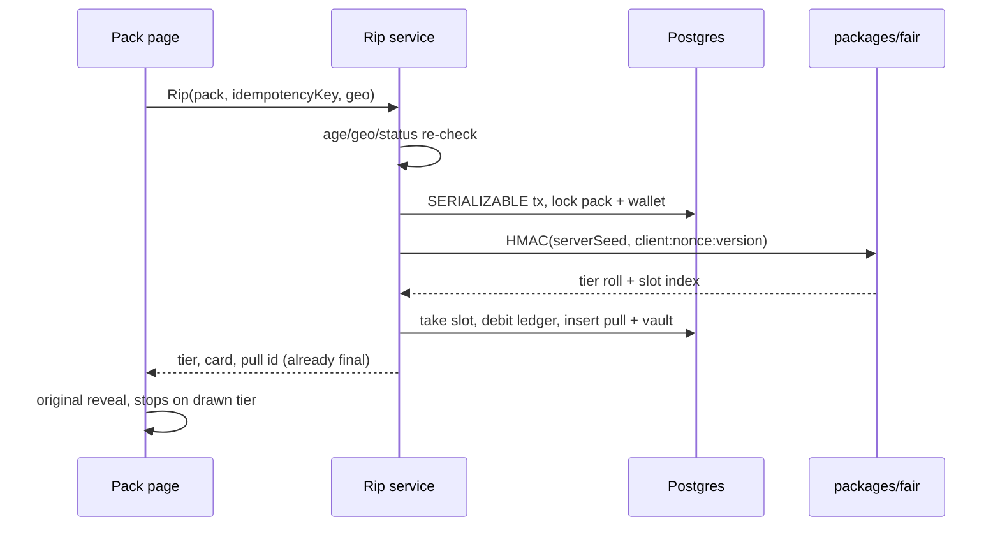

# Card Digital Rip — Technical Plan

MVP implementation plan for spec v2 (`docs/SPEC.md`). This document is the engineering map for the week-1/2 build and the leftovers that stay behind flags or later milestones.

The spec names Drizzle. This repo uses **Prisma** against Postgres, per the build request. Everything else in §19 that the week-1/2 slice needs is adopted; processors, KYC vendors, MaxMind, Shippo, Rive binaries, and realtime sockets are interfaces or stubs, not live integrations.

## Architecture

```text
browser (Next.js UI)
  │  server actions + route handlers
  ▼
app/                         consumer + admin UI, session cookie
  │
  ├── packages/fair          HMAC commit-reveal draw + public verifier
  ├── packages/econ          GM%, RTP*, pack validator, example pack math
  ├── packages/risk          age gate, blocked-state list, funding-hold clock
  └── db/                    Prisma schema, ledger, rip, buyback, CSV, seed
        │
        ▼
     Postgres                ledger trigger (no UPDATE/DELETE)
                             ledger_app role: SELECT + INSERT only
```

One Next.js process owns the UI and the route handlers. Domain rules that must be tested without a browser live in `packages/*` and `db/src` so Vitest can hit them directly. The UI is a thin caller.

Money movement and the draw share a single serializable transaction that locks the pack row, then the wallet row. The animation never decides the outcome. The server writes the pull, then the client plays it back.



## Components

### Consumer app (`app/`)

Mobile-first Next.js App Router UI.

| Route | Role |
|---|---|
| `/` | Landing, trust strip, featured tiers, example-inventory notice |
| `/signup`, `/login` | Email + password, DOB, state. Under 18 and blocked states go to `/restricted` and are logged |
| `/catalog`, `/packs/[slug]` | Three live tiers. Pack page shows price, odds, full pool, EV, RTP, 90% buyback, stock, server-seed hash, fees |
| `/rip/[pullId]` | Original reveal, then Keep / Buy back |
| `/vault` | Owned slabs, FMV, ship-hold badge, buyback, ship request |
| `/wallet` | Available vs on-hold credits, ledger history, stub top-up |
| `/verify/[pullId]` | Recompute a pull once the server seed is revealed |
| `/settings` | Client seed, skip animation, seed rotation |
| `/odds`, `/how-it-works` | Plain-language disclosure |
| `/admin/cards` | CSV dry-run + atomic commit |
| `/admin/packs` | Pack builder and margin guard |

Sessions are HMAC-signed httpOnly cookies (`SESSION_SECRET`). Passwords are scrypt. There is no Auth.js, Google, or Apple adapter in this slice.

Demo accounts are seeded. Inventory is marked `example = true` and rendered with generative slab art (cert-derived SVG). No photographed cards, no competitor assets.

### Rip / reveal engine

`app/lib/reveal/machine.ts` is the reveal state machine. Inputs match the spec's Rive contract so a future `.riv` file can replace the view without changing the draw:

- `tier` 0–4 (common → grail)
- `isGrail`
- `skip`

Phases: arm (0.5s) → rarity meter → tier burst → slab flip → decision. Total about 4–6s. `meterPositionAt` clamps to tick `drawnTier + 1`, and the view does not animate a near-miss past it. Skip and `prefers-reduced-motion` jump to the decision with the slab visible.

The reveal is original CSS/SVG (sleeve, assay meter, slab flip). Rive is not shipped in this slice: a placeholder binary would be someone else's runtime asset, and the acceptance we can actually lock in is the state machine ("bar never exceeds drawn tier"). The meter stops on tick `drawnTier + 1` (a common stops at tick 1 and never travels toward rare). The active server seed is the row with `active = true`. A revealed seed is never used for a new draw.

### Provably-fair draw service

`packages/fair`.

- Server seed is 32 random bytes, stored server-side. SHA-256 is published on the pack page before use.
- `h = HMAC_SHA256(serverSeed, "{clientSeed}:{nonce}:{packVersion}")` (UTF-8).
- Tier: uint32 big-endian from the digest, rejection-sampled modulo 10_000, compared to cumulative `odds_bps`.
- Card: the next uint32, rejection-sampled modulo the count of **available slots ordered by `slot_index`**.
- If a block is exhausted, the next block is `HMAC(serverSeed, "{message}:{n}")` for n = 1, 2, … The first block has no suffix, matching the spec string exactly.
- The ordered slot-id list and its SHA-256 are stored on the pull.
- Nonce is per `(user, server seed)`, starting at 0.
- Empty tier pauses the pack and does not charge. Odds are not redistributed inside a version.
- Rotation reveals the current seed and activates a new one. Until reveal, the verify page shows the commit hash and a house check, and does not leak the seed. After reveal, anyone can recompute with `packages/fair`.

Published vectors live in `packages/fair/vectors/published.json`.

### Pack builder with margin guard

`packages/econ` owns the formulas and the validator. Admin → Packs runs the same function in the browser for the live readout and again on the server before any write.

Gross margin per $ of rip revenue (§5.2):

```text
GM = 1 − RTP × [β·b + (1−β)·k] − f
RTP* = (1 − f − m) / [β·b + (1−β)·k]
```

Base case used everywhere unless a caller overrides it (§5.3, all example figures): β = 0.92, b = 0.90, k = 0.85, f = 0.045, target m = 5%.

Publish is rejected when any of these fail:

| Code | Rule |
|---|---|
| `ODDS_SUM` | tier odds do not sum to 10_000 bps |
| `RTP_BAND` | RTP outside [98%, 103%] |
| `MARGIN` | GM < 4% at the base-case β, b, k, f |
| `CARD_EV_SHARE` | any card's probability-weighted FMV exceeds 10% of pack EV |
| `TIER_DEPTH` | a tier with odds has fewer than 3 cards |
| `STALE_PRICE` | FMV older than 7 days, or 24h if FMV > $1,000 |
| `LIABILITY` | sum of allocated FMV exceeds in-custody inventory FMV |
| `MISSING_IMAGE` | allocated card is missing front or back art |
| `DUPLICATE_CARD` | same card in two slots |

A seeded draft (`draft-thin-margin`) is built to fail this gate so the admin screen shows a blocked publish. The $25 / $100 / $500 packs pass and are live. EV on the pack page is the **version's** stock-weighted EV, not a re-roll of whatever stock is left.

### Credits wallet + buyback

There is no cash-out. `stubTopUp` (`db/src/wallet.ts`) records a `payments` row with `provider = stub` and `status = stubbed`. It never calls a processor and never charges a card.

Top-up credits the ledger (`funding_source = card`) and increases spendable balance immediately. A daily top-up limit is enforced (default $500 for new accounts; the demo ripper is seeded higher so the three pack prices can be exercised).

Buyback credit is:

```text
creditCents = floor(fmvCents × haircut × b)
```

`b = 90%` (9_000 bps). Low price-confidence uses a 0.9 haircut; high confidence uses 1. The offer is an explicit confirm, locked conceptually for 10 minutes; an expired offer cannot be accepted. Credits are `funding_source = credit_buyback`. The slab returns to `available` (house inventory) and the vault row becomes `bought_back`. Buyback is blocked when the user is locked or the vault row is flagged `buyback_blocked` (dispute/chargeback stand-in). A funding ship-hold does **not** block buyback: §11 stops the slab leaving the building, and the re-rip loop has to keep working.

Ledger rules:

- Every journal is two legs sharing `journal_id`: the user account and `house:offset`. Debits equal credits.
- Amounts are positive integers. A debit that would make the user balance negative is refused and writes nothing.
- `ledger_entries` has a trigger that rejects UPDATE and DELETE.
- Role `ledger_app` is granted only SELECT and INSERT on `ledger_entries`.
- The wallet row is a cache. Tests require `available_cents = Σ user credits − Σ user debits`.

### Vault / shipping

A pull inserts a `vault_items` row in the same transaction as the debit. The vault shows grade, cert, FMV, and a ship-hold badge when fresh card funds paid for the pull.

Ship request (`db/src/shipping.ts`):

- Flat fee shown as $7.99 (example). Not collected in this slice (no Shippo).
- If `ship_hold_until` is in the future and KYC is not `passed`, the shipment is stored as `waiting_hold` with `hold_reason = funding_hold`. It is not `requested`.
- Otherwise the shipment is `requested`. No label is bought.

### Admin card loader (CSV)

`db/src/csv.ts`. UTF-8, header row, RFC-style quotes. Dry-run validates and writes zero rows. Commit is one transaction: any bad row writes nothing.

Required columns match §15: `grader`, `cert_number`, `grade`, `category`, `subject`, `set_name`, `year`, `fmv_usd`, `fmv_source`, `fmv_date`, `cost_basis_usd`, `owner`, `custody_location`, `bin`. Optional: `card_number`, `variant`, `supplier_id`, `image_front_url`, `image_back_url`, and `feed_value_usd` (used for the 2× feed reject; there is no licensed feed in this slice).

Rejects include duplicate cert (file or database), missing required fields, grader/category/grade/year range, stale `fmv_date`, owner `supplier` without `supplier_id`, non-positive FMV, and FMV greater than twice `feed_value_usd` when that column is present. Images are optional at intake and required before allocation.

### Fraud holds

Stub of §11, enough to close the "rip then ship" path in the data model:

- Card top-ups set `wallets.funding_hold_until`: 7 days for the first card top-up, 72 hours after that.
- Spend uses held card cents first. If any of the pack price comes from still-held card cents and KYC is not passed, `vault_items.ship_hold_until` is set.
- Those credits can still rip and can still be bought back.
- KYC `passed` clears the ship hold.
- `buyback_blocked` / user `locked` stand in for dispute and chargeback. The Stripe webhook, 3DS, and evidence pack are not built.

### Geo / age gate stubs

`packages/risk`.

- Minimum age 18. The birthday itself is allowed. Checked at signup against the submitted DOB. Rejected attempts are logged in `geo_checks` and do not create a user.
- Blocked states: WA, NV, MI, ID, MT, OK (§18). Signup uses the declared state.
- Rip re-checks the account state **and** the `x-geo-state` request header (the stand-in for MaxMind + browser geo). Either one blocked fails the rip with no debit.
- Production IP, VPN, and billing-address checks are not wired. The header exists so tests and demos can simulate them.

## Data model

Postgres via Prisma. Table names are snake_case. Status machines follow §16.

```text
users ── wallets
  │  └── ledger_entries (immutable, double-entry)
  │  └── payments (stub provider)
  │  └── user_limits
  │  └── geo_checks
  │
  ├── pulls ── server_seeds
  │     └── vault_items ── buybacks
  │                    └── shipments
  │
packs ── pack_tiers (odds_bps per version)
    └── pack_slots (ordered slot_index, card_id, state)

cards ── price_history
    └── card_events

admin_audits
```

Card status: `intake → available → allocated → pulled → (shipping → shipped) | (bought_back → available)`. `frozen` is reserved for a later audit mismatch.

Slot state: `available | pulled`. A bought-back card does not re-enter its old slot. Restock into a new version is a later milestone, which keeps a published version's odds fixed.

Pull row carries everything the verifier needs: `seed_id`, `client_seed`, `nonce`, `pack version`, `tier`, `pool_index`, `slot_id`, `hmac`, `available_slot_ids`, `slot_list_hash`, `funding_source`, `idempotency_key`.

## Example catalog

Seeded by `db/prisma/seed.ts`. All of it is EXAMPLE data: fictional subjects, `EX######` certs, generative art. Not real slabs and not a price feed.

| Pack | Price | EV | RTP | GM at base case |
|---|---|---|---|---|
| `pack-25` | $25 | $25.20 | 100.80% | ~5.2% |
| `pack-100` | $100 | $100.94 | 100.94% | ~5.1% (matches §5.6) |
| `pack-500` | $500 | $504.80 | 100.96% | ~5.0% |

Odds for `pack-100` are the §5.6 table (72 / 20 / 6.5 / 1.4 / 0.1). Each open tier has at least 3 cards. 200 cards total, including two admin drafts (`draft-ok`, `draft-thin-margin`) and spare `available` stock for the builder.

Demo logins (also in the README):

- `ada@example.com` / `rip-demo` — ripper, California, seeded credits
- `admin@example.com` / `admin-demo` — admin

One revealed historical pull, id `pull_example`, is seeded so `/verify/pull_example` recomputes in public without waiting for a rotation.

## Idempotency and concurrency

`POST /api/rip` takes an `idempotencyKey`. The same key returns the original pull and does not debit again. A key reused for a different pack is a conflict.

The draw transaction is `SERIALIZABLE` and takes `FOR UPDATE` on the pack, then the wallet. Slot claim is a conditional update (`state = available`). Serialization failures retry. A 10-slot pack under 100 concurrent rips yields 10 pulls, 10 debits, and no shared card.

## Testing

| Acceptance | Where |
|---|---|
| GM% and RTP* match §5.3 within 0.1 pt | `packages/econ/test/margin.test.ts` |
| Validator rejects each publish rule, including GM < 4% | `packages/econ/test/validate.test.ts` |
| Published vectors, rejection sampling, 1M-roll Monte Carlo ±0.2 pt | `packages/fair/test` |
| Age and blocked-state decisions | `packages/risk/test/gates.test.ts` |
| Reveal meter never passes the drawn tier | `app/test/reveal.test.ts` |
| Ledger: 10k random ops, balance = Σ entries, never negative, no update/delete, role grants | `db/test/ledger.test.ts` |
| Signup DOB < 18 blocked; blocked state blocked | `db/test/auth.test.ts` + Playwright |
| Geo re-checked on rip | `db/test/rip.test.ts` |
| Rip idempotent; 100 concurrent rips, 10-slot pack | `db/test/rip.test.ts` |
| Verify recomputes 100 pulls | `db/test/rip.test.ts` |
| Pack page odds, pool, EV, buyback, seed hash | Playwright |
| CSV reject rules; dry-run writes 0; bad commit writes 0 | `db/test/csv.test.ts` |
| Buyback floor formula, expiry, dispute block | `db/test/buyback.test.ts` |
| Publish blocked under 4% GM | `db/test/packs.test.ts` |
| Ship hold blocks a clean ship request | `db/test/shipping.test.ts` |

`pnpm test` migrates, seeds, and runs Vitest in one process (DB tests are serial). `pnpm e2e` runs Playwright against `next dev`.

## Local run

See the README. Short version: Postgres 16, `DATABASE_URL`, `pnpm install`, `pnpm db:migrate`, `pnpm db:seed`, `pnpm dev`. Payments stay on the stub. No API keys.

## Milestone checklist

Boxes mark this repo, not the whole company launch. Week 3–4 items are listed so the next agent can pick them up without rereading the spec.

### Week 1 — Foundation + money core

- [x] Scaffold, CI, seeded demo (200 EXAMPLE cards, 3 live packs)
- [x] Auth; DOB under 18 blocked; blocked states WA/NV/MI/ID/MT/OK blocked; both logged
- [x] Geo re-checked on the rip path (`x-geo-state` stub, not MaxMind)
- [x] Ledger property test, immutability trigger, `ledger_app` without UPDATE/DELETE
- [x] `packages/econ` GM% and RTP* match §5.3 within 0.1 pt
- [ ] Auth.js email OTP, Google, Apple (password session only for now)
- [ ] Real payments (intentionally stubbed)

### Week 2 — Packs, fairness, rip

- [x] `packages/fair` vectors, rejection sampling, 1M-roll Monte Carlo
- [x] Validator: odds sum, RTP band, GM ≥ 4%, card EV share, tier depth, stale price, liability
- [x] Rip idempotent; 100 concurrent rips on a 10-slot pack
- [x] Pack page shows odds, pool, EV, buyback %, seed hash
- [x] Verify recomputes pulls (100 in integration, example pull in the UI)
- [x] Reveal state machine: meter never exceeds the drawn tier
- [ ] Rive file under 300 KB and a Pixel 6a 60 fps trace (original CSS/SVG ships instead)
- [ ] Rip x3 sequential open

### Week 3 — Buyback, ship, fraud, admin

- [x] Buyback = floor(FMV × haircut × rate); expiry enforced; blocked on dispute flag
- [x] Funding hold: fresh card funds can rip, cannot ship cleanly before hold/KYC
- [x] CSV validation, dry-run writes nothing, atomic commit
- [x] Margin guard blocks publish under 4%
- [ ] Chargeback webhook: lock, reverse credits, recall unshipped (needs a processor)
- [ ] Nightly price refresh and auto-pause on a > 10% drop
- [ ] Shippo test label, SLA timer, fulfillment queue
- [ ] Deposit-limit increase delayed 24h; self-exclusion blocks rip end-to-end in the UI
- [ ] Licensed price feed (Card Ladder / Alt / PriceCharting)

### Week 4 — Polish and launch gates

- [ ] Final Rive, image prefetch budget, reduced-motion already stubbed in CSS
- [ ] KYC sandbox at the §11 thresholds
- [ ] Second-admin approve for publishing a ≥ $500 pack
- [ ] Every admin mutation already writes `admin_audits` for CSV and pack publish; extend to the rest
- [ ] k6 at 200 rips/s
- [ ] §20 metrics dashboard
- [ ] Lighthouse mobile ≥ 85 as a gate

### Explicitly out of this repo

Phase 2 marketplace, rip rooms, P2P, VRF, cash-out, $10K tier, turbo buyback, volatility modes, VIP perks, crypto. Counsel, processor approval, custody contract, and insurance are launch gates in §23, not code.
